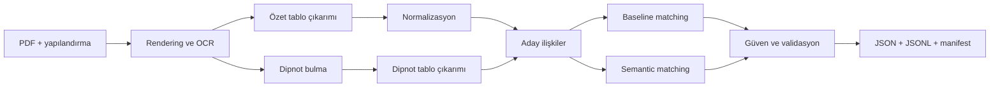
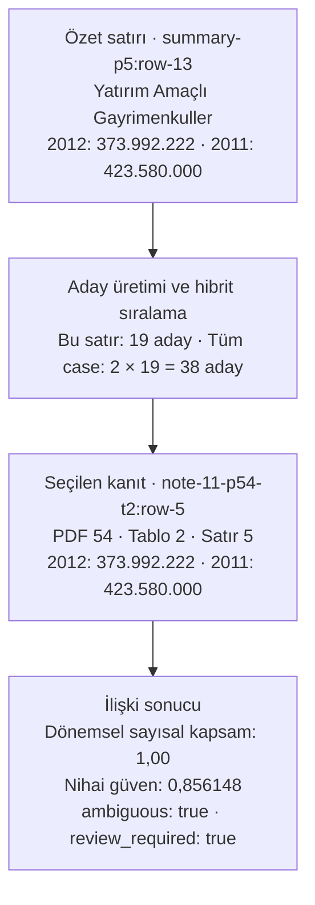

# Case Study

## 1. Teslim İçeriği ve Önemli Dosyalar

Bu repository; kaynak kodu, kullanılan vaka dokümanını, tekrar üretilebilir çalışma yapılandırmasını, otomatik testleri ve doğrulanmış örnek çalışma çıktılarını birlikte içerir. Uçtan uca son çalışma `completed_with_warnings` durumuyla tamamlanmıştır: zorunlu yedi aşamanın tamamı çalışmış, durdurma gerektiren kalite kapısı veya başarısız validasyon oluşmamış, OCR kaynaklı üç finansal kontrol ise değer uydurulmadan `incomplete` olarak raporlanmıştır.

### 1.1. Hızlı Başlangıç

Aşağıdaki blok macOS ve Python 3.11+ üzerinde repository'yi klonlar, gerekli sistem araçlarını ve sabitlenmiş Python bağımlılıklarını kurar, testleri çalıştırır ve yedi aşamalı pipeline'ı başlatır:

```bash
git clone https://github.com/safakelkit/case_ocr.git
cd case_ocr

brew install poppler tesseract tesseract-lang

python3 -m venv .venv
source .venv/bin/activate
python -m pip install --upgrade pip
python -m pip install -r requirements.txt

python -m unittest discover -s tests -v
ykt-case --config configs/default.json --stage all
```

İlk semantic çalışmada embedding modeli indirileceği için internet bağlantısı gerekebilir. Sonuçlar `outputs/` altında üretilir. Sistem aracı kontrolleri, çevrimdışı model kullanımı ve aşama bazlı komutlar için [Bölüm 5](#5-kurulum-ve-uçtan-uca-çalıştırma) ile [`RUNBOOK.local.md`](RUNBOOK.local.md) kullanılabilir.

### 1.2. Öncelikli Teslim Artefaktları

| Dosya | İçerik ve kullanım amacı |
|---|---|
| [`outputs/result.json`](outputs/result.json) | Yapılandırılmış özet tabloları, bulunan dipnotu ve dipnot tablolarını, otomatik satır ilişkilerini, güven skorlarını, inceleme bayraklarını, validasyon sonuçlarını ve uyarıları içeren ana teslim çıktısıdır. |
| [`outputs/run_manifest.json`](outputs/run_manifest.json) | Kaynak ve konfigürasyon checksum'larını, Python ve bağımlılık sürümlerini, model kimliği/revizyonunu, cihaz bilgisini, seed'i, aşama sürelerini, kalite kapılarını, fallback olaylarını ve nihai çıktı checksum'ını içerir. |
| [`outputs/run_events.jsonl`](outputs/run_events.jsonl) | Uçtan uca çalışmanın aşama başlangıç, bitiş ve sonuç olaylarını satır bazlı JSONL biçiminde saklar. |
| [`outputs/delivery_index.json`](outputs/delivery_index.json) | Case gereksinimlerini ilgili teslim dosyası ve JSON alanıyla eşler; sekiz runtime/değerlendirme artefaktının boyut ve SHA-256 değerlerini kaydeder. |
| [`data/source/report.pdf`](data/source/report.pdf) | Pipeline'ın işlediği kaynak KAP raporudur. Doğrulanan SHA-256 değeri `25e4afe4c27bd2b3bb17a943a323e265520e68981c349f300d9248b3f3bfd7e0` şeklindedir. |
| [`configs/default.json`](configs/default.json) | Özet sayfa aralığını, hedef dipnot numarasını, OCR ayarlarını, model ayarlarını, çıktı yollarını ve kalite kapılarını tanımlayan varsayılan çalışma yapılandırmasıdır. Sayfa 5–7 ve Dipnot 11 bilgileri iş mantığında değil bu dosyada tutulur. |

### 1.3. Değerlendirme ve Karşılaştırma Raporları

| Dosya | İçerik ve kullanım amacı |
|---|---|
| [`outputs/evaluation/baseline_relation_evaluation.json`](outputs/evaluation/baseline_relation_evaluation.json) | Lexical, sayısal ve yapısal baseline yönteminin iki insan kontrollü ilişki üzerindeki keşifsel değerlendirmesidir. |
| [`outputs/evaluation/semantic_relation_evaluation.json`](outputs/evaluation/semantic_relation_evaluation.json) | Multilingual embedding kullanan yöntemin aynı kontrol kümesi ve aynı metriklerle değerlendirmesidir. |
| [`outputs/evaluation/relation_method_comparison.json`](outputs/evaluation/relation_method_comparison.json) | Baseline ve semantic yöntemlerin seçilen satırlarını, metriklerini ve örnek bazlı sıralama farklarını karşılaştırır. |
| [`outputs/evaluation/embedding_model_benchmark.json`](outputs/evaluation/embedding_model_benchmark.json) | Üç multilingual embedding modelini aynı 38 aday, sabit hibrit skor yapısı, CPU ayarı ve evaluator ile karşılaştırır. |
| [`outputs/evaluation/psm_comparison.json`](outputs/evaluation/psm_comparison.json) | Tesseract PSM 3, 4, 6 ve 11 ayarlarının sabit kontrol örneklerindeki sonuçlarını ve PSM 3 seçim gerekçesini içerir. |

Bu metrikler yalnızca sağlanan vaka üzerindeki iki insan kontrollü ilişkiye dayanır. Genel model başarısı veya istatistiksel olarak kalibre edilmiş performans iddiası olarak yorumlanmamalıdır.

### 1.4. Kaynak Kod, Kurulum ve Testler

| Yol | İçerik ve kullanım amacı |
|---|---|
| [`src/ykt_case/`](src/ykt_case/) | Rendering, OCR, tablo çıkarımı, normalizasyon, dipnot bulma, aday üretimi, iki eşleştirme yaklaşımı, güven birleştirme, validasyon ve orchestration kodudur. |
| [`scripts/`](scripts/) | PSM karşılaştırması, ilişki değerlendirmesi, yöntem karşılaştırması, embedding benchmarkı ve teslim artefaktı hazırlama komutlarını içerir. |
| [`tests/`](tests/) | Normalizasyon, yapılandırma, sayfa/dipnot bulma, tablo çıkarımı, matching, fallback, güven, validasyon, orchestration ve teslim paketleme davranışlarını kapsayan 66 otomatik testtir. |
| [`requirements.txt`](requirements.txt) | Temiz ortamda doğrulanan doğrudan ve geçişli Python bağımlılıklarının sabit sürümlerini ve normal yerel wheel kurulumunu içerir. |
| [`pyproject.toml`](pyproject.toml) | Paket metadatasını, `ykt-case` terminal komutunu, doğrudan bağımlılıkları ve sabit build backend sürümünü tanımlar. |
| [`evaluation/`](evaluation/) | Runtime tahminlerinden ayrı tutulan insan kontrollü ilişki beklentilerini ve OCR kontrol örneklerini içerir; bu dosyalar pipeline'a cevap olarak enjekte edilmez. |

Temel Python dosyaları aşağıdaki haritada özetlenmiştir. Her `.py` dosyasında neden kullanıldığını belirten kısa bir Türkçe amaç yorumu bulunur. Paket modüllerinde bu açıklama ilk satırdadır; doğrudan çalıştırılabilen `scripts/*.py` dosyalarında ise Unix `shebang` satırının hemen altında yer alır. Test dosyaları bu tabloyu gereksiz büyütmemek için tek tek listelenmemiştir.

#### Kaynak Kod Haritası

| Dosya | Pipeline'daki sorumluluğu |
|---|---|
| [`src/ykt_case/cli.py`](src/ykt_case/cli.py) | Komut satırı argümanlarını alır ve seçilen aşamayı ya da uçtan uca çalışmayı başlatır. |
| [`src/ykt_case/config.py`](src/ykt_case/config.py) | Sayfa, dipnot, OCR, model, eşik ve çıktı ayarlarını doğrulanmış yapılandırma nesnesine dönüştürür. |
| [`src/ykt_case/orchestration.py`](src/ykt_case/orchestration.py), [`src/ykt_case/pipeline.py`](src/ykt_case/pipeline.py) | Aşamaların sırasını, çalışma olaylarını, kalite kapılarını, fallback kayıtlarını ve nihai çıktı birleştirmesini yönetir. |
| [`src/ykt_case/rendering.py`](src/ykt_case/rendering.py), [`src/ykt_case/ocr.py`](src/ykt_case/ocr.py) | PDF sayfalarını görüntüye dönüştürür; Tesseract metin, koordinat ve güven kanıtını üretir. |
| [`src/ykt_case/summary_tables.py`](src/ykt_case/summary_tables.py) | Yapılandırılan özet sayfalardaki başlık, satır, sütun, hücre, dipnot referansı ve hiyerarşiyi çıkarır. |
| [`src/ykt_case/normalization.py`](src/ykt_case/normalization.py) | Finansal metni normalize eder; parantezli negatifleri, binlik ayırıcıları, tireyi, boş hücreyi ve sıfırı ayrıştırır. |
| [`src/ykt_case/note_locator.py`](src/ykt_case/note_locator.py) | Hedef dipnot başlığını doküman genelindeki OCR kanıtından, sayfa konumu enjekte edilmeden bulur. |
| [`src/ykt_case/note_tables.py`](src/ykt_case/note_tables.py) | Bulunan dipnot sayfalarındaki tabloları, satırları, sütunları, hücreleri ve kaynak koordinatlarını yapılandırır. |
| [`src/ykt_case/matching.py`](src/ykt_case/matching.py) | Lexical/fuzzy, sayısal ve yapısal kanıtlarla açıklanabilir baseline aday üretimi ve eşleştirmeyi gerçekleştirir. |
| [`src/ykt_case/semantic_matching.py`](src/ykt_case/semantic_matching.py) | Multilingual embedding benzerliğini sayısal ve yapısal kanıtlarla birleştiren semantic yaklaşımı çalıştırır. |
| [`src/ykt_case/validation.py`](src/ykt_case/validation.py) | Şema, dönem, sayısal tutarlılık, ilişki ve güven kontrollerini çalıştırıp bulguları sınıflandırır. |
| [`src/ykt_case/schemas.py`](src/ykt_case/schemas.py), [`src/ykt_case/progress.py`](src/ykt_case/progress.py) | Ortak veri sözleşmelerini ve uzun süren aşamaların terminal ilerleme görünümünü sağlar. |
| [`scripts/psm_comparison.py`](scripts/psm_comparison.py) | PSM 3, 4, 6 ve 11'i aynı OCR beklentileri üzerinde tekrar üretilebilir biçimde karşılaştırır. |
| [`scripts/evaluate_relations.py`](scripts/evaluate_relations.py), [`scripts/compare_relation_methods.py`](scripts/compare_relation_methods.py) | Tahminleri ayrı insan kontrollü beklentilerle değerlendirir ve baseline–semantic sonuçlarını aynı sözleşmede karşılaştırır. |
| [`scripts/benchmark_embedding_models.py`](scripts/benchmark_embedding_models.py), [`scripts/prepare_delivery_artifacts.py`](scripts/prepare_delivery_artifacts.py) | Embedding modellerini sabit aday kümesinde kıyaslar; doğrulanmış raporları sabit teslim yollarına taşıyıp kanıt indeksini üretir. |

### 1.5. Mühendislik Kayıtları

| Dosya | İçerik ve kullanım amacı |
|---|---|
| [`ERRORS.local.md`](ERRORS.local.md) | Gerçek doküman ve temiz kurulum sırasında gözlenen hataları; belirti, kök neden, çözüm ve regresyon kanıtıyla kaydeder. |
| [`DECISIONS.local.md`](DECISIONS.local.md) | OCR, model, matching, güven, fallback, teslim yapısı ve veri akışıyla ilgili teknik kararları ve değerlendirilen alternatifleri saklar. |
| [`RUNBOOK.local.md`](RUNBOOK.local.md) | Geliştirme sürecinde doğrulanmış kurulum, aşama çalıştırma, değerlendirme ve sorun giderme komutlarının ayrıntılı kaydıdır. |
| [`TASKS.md`](TASKS.md) | Case gereksinimlerinden türetilmiş görevleri ve doğrulama durumlarını gösterir. |
| [`MEMORY.md`](MEMORY.md) | Yalnızca doğrulanmış proje gerçeklerini, ölçümleri ve bilinen sınırlamaları tutan çalışma hafızasıdır. |
| [`AGENTS.md`](AGENTS.md) | Geliştirme boyunca uygulanan kapsam, güvenlik, veri işleme ve kalite kurallarını içerir. |

## 2. Problem Tanımı ve Kapsam

Bu çalışmanın amacı, taranmış bir finansal rapordaki yapılandırılmış özet tabloları çıkarmak, özet satırlarında referans verilen dipnotu doküman genelinde otomatik olarak bulmak ve ilgili özet kalemlerini dipnot tablolarındaki açıklayıcı satırlarla ilişkilendirmektir. Sağlanan vaka için özet tablolar PDF sayfa 5–7, hedef ise Dipnot 11'dir; bu bilgiler iş mantığına gömülmemiş, [`configs/default.json`](configs/default.json) üzerinden yapılandırılmıştır.

### 2.1. Case Kapsamında Beklenenler

- Tablo başlığı, satır/sütun başlıkları, dönemler, dipnot referansları, finansal değerler ve ana/alt/toplam ilişkileriyle yapılandırılmış çıktı üretmek.
- Ham OCR metnini korurken parantezli negatif değerleri ve noktalı binlik ayırıcıları normalize etmek; tire, boş hücre ve sıfırı birbirinden ayırmak.
- Hedef dipnotun sayfalarını bilinen konumunu enjekte etmeden bulmak ve altındaki tabloları çıkarmak.
- Özet satırları ile dipnot satırlarını en az iki matching yaklaşımıyla eşleştirmek; sıfır, bir veya birden fazla ilişkiyi desteklemek.
- Tablo, satır, hücre ve ilişki seviyesinde kanıta dayalı güven değerleri üretmek; düşük güveni ve belirsizliği açıkça işaretlemek.
- Yapısal, biçimsel ve finansal kontrolleri çalıştırarak JSON/JSONL sonuçları ile tekrar üretilebilir çalışma manifesti sunmak.

### 2.2. Kapsam Dışı Bırakılanlar

Bu vaka için kullanıcı arayüzü, web servisi, veritabanı, üretim altyapısı, model eğitimi/fine-tuning, dokümandaki tüm dipnotların çıkarılması ve kapsamlı OCR motoru benchmarkı hedeflenmemiştir. Öncelik, yapılandırılan sayfa ve dipnotlar için yerel çalışan, incelenebilir ve tekrar üretilebilir uçtan uca bir minimum uygulanabilir pipeline'dır.

## 3. Çözümün Kısa Özeti

Çözüm, dokümanı tek seferde bir LLM'e gönderip nihai JSON istemek yerine açık ve denetlenebilir aşamalara böler. Yapılandırılan özet sayfalar yerel olarak görüntüye dönüştürülüp Tesseract ile OCR'dan geçirilir; token metinleri, güven değerleri ve koordinatları kullanılarak finansal tablolar geometrik olarak yeniden oluşturulur. Aynı pipeline, hedef dipnotu tüm dokümanda otomatik olarak arar, bulunan sayfalardaki dipnot tablolarını çıkarır ve ham OCR kanıtını normalize değerlerle birlikte korur.

İlişki kurma aşamasında önce açıklanabilir bir lexical–sayısal–yapısal baseline, ardından multilingual embedding kullanan semantic yaklaşım çalıştırılır. Finansal dönem değerlerinin kapsamı seçim için zorunlu kanıt olarak tutulur; model benzerliği tek başına karar vermez. Son aşamada güven değerleri farklı kanıt kaynaklarından birleştirilir, yapısal/biçimsel/finansal kontroller uygulanır ve düşük güvenli, belirsiz veya eksik sonuçlar başarılıymış gibi gizlenmeden işaretlenir.

`PDF → rendering/OCR → tablo yapılandırma ve normalizasyon → dipnot bulma/çıkarma → aday üretimi → baseline ve semantic matching → güven ve validasyon → JSON/JSONL teslim çıktıları`

## 4. Sistem Mimarisi ve Uçtan Uca Pipeline

Pipeline, her aşamanın girdisini ve çıktısını ayrı artefaktlarda tutar. Böylece OCR, tablo çıkarımı, eşleştirme veya validasyon sonucu tek başına incelenebilir; bir aşamadaki hata sonraki aşamalarda gizlenmez.



### 4.1. Yapılandırma ve Sayfa Numaralandırma

Kaynak dosya, özet sayfalar, hedef dipnotlar, OCR ayarları, model ve kalite eşikleri [`configs/default.json`](configs/default.json) üzerinden alınır. Kullanıcıya gösterilen PDF sayfaları birden başlar; kütüphanelerin kullandığı sıfır tabanlı değer `page_index`, dokümanda basılı bir numara varsa `printed_page_number` olarak ayrıca saklanır. Böylece PDF sayfası, dahili indeks ve basılı sayfa birbirine karıştırılmaz.

### 4.2. PDF Görüntüleme ve OCR

Kaynak raporda kullanılabilir bir metin katmanı bulunmadığı için sayfalar `pdftoppm` ile görüntüye dönüştürülür ve yerel Tesseract kurulumu ile işlenir. Ölçülen varsayılan ayarlar şöyledir:

| İşlem | DPI | Tesseract ayarı | Amaç |
|---|---:|---|---|
| Özet tablo sayfaları | 300 | `tur+eng`, PSM 3 | Finansal tablo metni ve geometrisi |
| Doküman geneli dipnot taraması | 110 | `tur+eng`, PSM 6 | 95 sayfada düşük maliyetli başlık araması |
| Bulunan dipnot sayfaları | 300 | `tur+eng`, PSM 3 | Dipnot tablolarının ayrıntılı çıkarımı |

Son doğrulanan ortamda Tesseract `5.5.2`, Poppler/pdftoppm `26.10.0` kullanılmıştır; gerçek sürümler her çalışmada manifest içine yeniden yazılır. Uzun rapor tek bir model girdisine dönüştürülmez: dipnot araması 95 sayfayı sayfa sayfa düşük çözünürlükte işler, yalnızca bulunan dipnot sayfalarını 300 DPI ile yeniden OCR'dan geçirir. Her OCR tokenı ham metni, bounding box koordinatını, sayfa kaynağını ve Tesseract güvenini korur. OCR kalitesi eşik altındaysa sonuç sessizce kabul edilmez; yapılandırılan kalite kapısı uyarı üretir veya işlemi durdurur. MVP'de ikinci bir OCR motoru otomatik fallback değildir; Tesseract çalışmazsa aşama açık hata verir.

### 4.3. Özet Finansal Tabloların Yapılandırılması

OCR tokenlarının yatay ve dikey konumlarından dönem ve dipnot sütunları bulunur; yakın tokenlar satır ve hücrelere gruplanır. Tablo başlığı, satır başlığı, sütun başlığı, veri hücresi, dipnot referansı, bölüm, ara toplam ve toplam rolleri açık alanlarla temsil edilir. Hiyerarşi; bölüm sınırları, girinti ve dönem bazında finansal mutabakat kanıtlarıyla kurulur. Toplama ilişkisi doğrulanamıyorsa sistem bir ilişki uydurmak yerine durumu çözümlenmemiş olarak bırakır.

### 4.4. Finansal Değer Normalizasyonu

Ham OCR değeri hiçbir zaman normalleştirilmiş değerle ezilmez. Doküman yereline göre `373.992.222` değeri `373992222`, `(49.167.330)` değeri `-49167330` olarak ayrıştırılır; ondalık virgül de desteklenir. Tire, boş hücre, sayısal sıfır ve geçersiz OCR birbirinden farklı durumlar olarak saklanır. Her hücre dönem, para birimi, sayfa ve koordinat kanıtını taşır.

### 4.5. Dipnotun Otomatik Bulunması ve Çıkarılması

Hedef dipnotun bilinen sayfası runtime'a verilmez. Düşük çözünürlüklü taramada başlık biçimi, hedef numara, sayfadaki konum ve finansal metin bağlamı birlikte değerlendirilir; devam sayfaları aynı dipnot altında birleştirilir. Bu yöntem Dipnot 11'i PDF sayfa 53–54'te otomatik bulmuş; sayfa 89'daki “11. UZUN VADELİ YÜKÜMLÜLÜKLER” satırını başlık olmadığı için elemiştir. Bulunan sayfalar yüksek çözünürlükte yeniden işlenerek dört tablo ve 19 satır çıkarılmış, okunamayan alanlar uyarılarıyla birlikte korunmuştur.

### 4.6. Aday İlişkilerin Üretilmesi

Yalnızca hedef dipnota referans veren özet satırları ile aynı dipnottan çıkarılan satırlar aday yapılır. Bu vaka için iki özet satırı ve 19 dipnot satırı `2 × 19 = 38` aday oluşturur. Büyük tablo tek bir embedding metnine sıkıştırılmaz; her özet–dipnot satır çifti kendi kısa bağlamıyla ayrı adaydır. Beklenen cevaplar aday üretimine veya skorlama koduna verilmez. Her aday için metinsel benzerlik, dönem değerlerinin kapsanması, yapısal uyum ve çıkarım kalitesi ayrı kanıtlar olarak hesaplanır; finansal değer kanıtı bulunmayan bir aday zorla seçilmez.

Aşağıdaki örnek, sayfa 5'teki bilanço kaleminin otomatik ilişki akışını gösterir. Bu özet satırı için 19 dipnot satırı adaydır; 38 sayısı iki hedef özet satırının tüm adaylarını ifade eder.



İki dönem değeri tam karşılansa da aynı bakiyeleri taşıyan başka savunulabilir satırlar bulunduğu için sistem sonucu kesinmiş gibi sunmaz; ilişkiyi inceleme bayrağıyla yayımlar.

### 4.7. Yaklaşım A: Lexical, Sayısal ve Yapısal Eşleştirme

Açıklanabilir baseline yaklaşımı aday skorunu şu ağırlıklarla hesaplar:

`aday skoru = 0,50 × sayısal kapsam + 0,25 × lexical benzerlik + 0,10 × yapısal uyum + 0,15 × çıkarım kalitesi`

En fazla beş aday tutulur ve asgari aday skoru `0,35` olarak uygulanır. Seçim, özet satırındaki henüz açıklanmamış dönem değerlerini kapsayan adayları önceliklendirir. Sonuç tek satırla sınırlı değildir: kanıta göre sıfır, bir veya birden fazla ilişki üretebilir; yetersiz kanıtta `abstained`, kısmi kapsamda `partial_match` durumu döner.

### 4.8. Yaklaşım B: Multilingual Embedding ile Eşleştirme

Semantic yaklaşım aynı 38 adayı ve aynı sayısal/yapısal seçim sözleşmesini kullanır; yalnızca lexical bileşeni multilingual embedding cosine benzerliğiyle değiştirir:

`aday skoru = 0,50 × sayısal kapsam + 0,25 × semantic benzerlik + 0,10 × yapısal uyum + 0,15 × çıkarım kalitesi`

Varsayılan model, CPU üzerinde FastEmbed/ONNX ile çalışan `sentence-transformers/paraphrase-multilingual-MiniLM-L12-v2` modelidir. Model girdisi satır etiketleri, satır türleri, dipnot numarası, dönemler ve sütun başlıklarından oluşur; finansal değerler embedding metnine eklenmez ve ayrı kanıt olarak değerlendirilir. Model yüklenemez veya inference başarısız olursa baseline sonucu fallback olarak kullanılabilir; tetikleyici hata, kaybedilen semantic kanıt ve fallback sonucu manifestte açıkça kaydedilir.

| Inference ayarı | Kullanılan değer veya politika |
|---|---|
| Provider ve sürüm | FastEmbed `0.9.0` |
| Model | `sentence-transformers/paraphrase-multilingual-MiniLM-L12-v2` |
| Çözülmüş model kaynağı | `Qdrant/paraphrase-multilingual-MiniLM-L12-v2-onnx-Q` |
| Model revision | `faf4aa4225822f3bc6376869cb1164e8e3feedd0`; konfigürasyondan indirme katmanına zorunlu parametre olarak aktarılır. |
| Runtime ve cihaz | ONNX Runtime, CPU |
| Embedding boyutu | `384` |
| CPU thread sayısı | `4` |
| Batch ayarı | Kod tarafından override edilmez; FastEmbed varsayılanı kullanılır. |
| Cache ve indirme | `work/models/fastembed`; ilk çalışmada indirme açık, cache oluştuktan sonra çevrimdışı kullanım desteklenir. |
| Embedding girdisi | Özet ve dipnot satırları için benzersiz kısa metin bağlamları; etiket, satır türü, dipnot numarası, dönem ve sütun başlıkları. |
| Girdiden hariç tutulanlar | Finansal değerler ve insan kontrollü beklenen cevaplar; sayılar ayrı kanıt olarak skorlanır. |
| Aday uzayı | `2` özet satırı × `19` dipnot satırı = `38` aday ilişki |
| Benzerlik | Cosine similarity; `[0, 1]` aralığına sınırlandırılır. |
| Hibrit skor | `0,50` sayısal kapsam + `0,25` semantic benzerlik + `0,10` yapısal uyum + `0,15` çıkarım kalitesi |
| Sıralama ve eşik | En fazla `5` aday; minimum aday skoru `0,35` |
| Seçim kuralı | Exact dönemsel sayısal kapsam zorunludur; embedding skoru tek başına ilişki seçemez. |
| Hata davranışı | Model yükleme/inference hatası kaydedilir ve adlandırılmış lexical–sayısal–yapısal baseline fallback'i çalışabilir. |

Çalışmaya ait kesin model metadatası [`outputs/run_manifest.json`](outputs/run_manifest.json) → `models`, karar ayarları ve girdi politikası ise [`outputs/result.json`](outputs/result.json) → `matching.selected_method` altında makine tarafından okunabilir biçimde saklanır.

### 4.9. Güven Skorları ve Doğrulama

Tablo, satır ve hücre güvenleri; OCR güveni, geometrik tutarlılık, alanların bulunabilirliği, ayrıştırma başarısı ve finansal kontroller gibi ilgili kanıtlardan üretilir. Nihai ilişki güveni ise aşağıdaki birleşimdir:

`ilişki güveni = 0,35 × matcher güveni + 0,25 × sayısal kapsam + 0,20 × çıkarım kalitesi + 0,20 × yöntemler arası anlaşma`

Belirsizlik, fallback ve eksik ilişki sırasıyla `0,90`, `0,85` ve `0,80` çarpanlarıyla güveni düşürür; her değer son olarak `[0, 1]` aralığına sınırlandırılır. Bunlar iki örneğe dayalı, istatistiksel olarak kalibre edilmiş olasılıklar değil; incelenebilir mühendislik güvenleridir.

Başlıca kalite kapıları aşağıdadır. Zorunlu yapısal kanıtların eksikliği işlemi durdururken, OCR kaynaklı kısmi bozulmalar veri uydurulmadan uyarılı sonuç üretir. Eşikler yalnızca bu dokümanı geçirmek için ayarlanmamış; incelenen hata örneklerinin finansal anlam üzerindeki riskine göre seçilmiş ve gerekçeleri yapılandırmada saklanmıştır.

| Kalite kapısı | Eşik | Son gözlem | Kapı geçilemezse uygulanacak aksiyon |
|---|---:|---:|---|
| Dönem başlığı kapsamı | `≥ 1,00` | `1,00` | Çalışmayı durdur |
| Dipnot bulma güveni | `≥ 0,80` | `0,956727` | Çalışmayı durdur |
| Dipnot değer parse oranı | `≥ 0,80` | `0,50` | Uyarıyla devam et |
| İlişki dönemsel değer kapsamı | `≥ 1,00` | `1,00` | Çalışmayı durdur |
| Minimum nihai ilişki güveni | `≥ 0,75` | `0,856148` | İnceleme uyarısıyla devam et |

On beş kalite kapısının tamamı, karşılaştırma yönü, gerekçe ve aksiyonlarıyla [`configs/default.json`](configs/default.json) içinde; son ölçülen değer ve sonuçlarıyla [`outputs/result.json`](outputs/result.json) → `validation.quality_gates` ve [`outputs/run_manifest.json`](outputs/run_manifest.json) → `quality_gates` altında bulunur.

Son aşama zorunlu tabloları ve dönemleri, veri tiplerini, sayfa/koordinat kaynağını, güven aralıklarını, sıfır/bir/çoklu ilişki yapısını ve finansal mutabakatları denetler. Düşük güvenli kayıtlar ortak `review_required` ve `quality_flags` alanlarıyla görünür kılınır. Teslim edilen temiz çalışmada bilanço eşitliği dahil 15 kontrol geçmiş, üç finansal kontrol eksik OCR kanıtı nedeniyle `incomplete`, bir kontrol uygulanamaz olarak raporlanmış; durdurucu hata veya sessiz fallback oluşmamıştır. Nihai durum bu nedenle `completed_with_warnings` olmuştur.

## 5. Kurulum ve Uçtan Uca Çalıştırma

Pipeline, PDF sayfalarını görüntülemek için Poppler'ı; yerel OCR için Türkçe ve İngilizce dil paketleriyle Tesseract'ı kullanır. Bunlar Python paketi olmadığı için macOS'ta Homebrew ile kurulur. Aşağıdaki zincir proje kökünde temiz bir Python ortamı oluşturur, sabitlenmiş bağımlılıkları yükler, kurulumu test eder ve gerçek pipeline çıktılarını üretir:

```bash
# Sistem araçları
brew install poppler tesseract tesseract-lang

# Temiz Python ortamı ve sabitlenmiş bağımlılıklar
python3 -m venv .venv
source .venv/bin/activate
python -m pip install --upgrade pip
python -m pip install -r requirements.txt

# Kurulum doğrulaması
pdftoppm -v
tesseract --list-langs
python -m pip check
python -m unittest discover -s tests -v

# Yedi aşamalı uçtan uca çalışma
ykt-case --config configs/default.json --stage all
```

`tesseract --list-langs` çıktısında `tur` ve `eng` bulunmalıdır. Uçtan uca komut sırasıyla özet OCR, tablo yapılandırma, dipnot bulma, dipnot tablo çıkarımı, baseline matching, semantic matching ve validasyon aşamalarını çalıştırır. Başarılı veya uyarılı bir çalışma sonunda ana sonuç [`outputs/result.json`](outputs/result.json), çalışma manifesti [`outputs/run_manifest.json`](outputs/run_manifest.json) ve olay günlüğü [`outputs/run_events.jsonl`](outputs/run_events.jsonl) yollarında oluşur. `failed` durumunda komut sıfırdan farklı çıkış koduyla sonlanır.

İlk semantic çalışmada yapılandırılmış herkese açık embedding modeli `work/models/fastembed/` altına indirilebilir; PDF, OCR metni veya finansal veri dış servise gönderilmez. Model cache'e alındıktan sonra [`configs/default.json`](configs/default.json) içindeki `semantic.allow_download` değeri `false` yapılarak yalnızca yerel cache ile çalışma zorlanabilir.

Aşamaları ayrı çalıştırma, değerlendirme deneylerini yeniden üretme ve teslim artefaktlarını paketleme komutları [`RUNBOOK.local.md`](RUNBOOK.local.md) dosyasında yer alır.

## 6. Çıktı Veri Modeli

Ana teslim çıktısı [`outputs/result.json`](outputs/result.json), doküman–tablo–satır–hücre hiyerarşisini ve satırlar arası ilişkileri iç içe saklayabilmek için JSON biçimindedir. Ham OCR kanıtı, normalize değer ve kaynak koordinatları aynı kayıt altında birlikte görülebilir. Çalışma olayları ise aşama bazında sırayla eklenebilen ve dosyanın tamamı yüklenmeden satır satır okunabilen JSONL biçimindeki [`outputs/run_events.jsonl`](outputs/run_events.jsonl) dosyasında tutulur.

### 6.1. Doküman ve Kaynak Bilgileri

Üst seviyede `schema_version`, `status`, `source`, `document`, `summary_tables`, `notes`, `matching`, `validation` ve `warnings` alanları bulunur. `source`, kaynak PDF'nin checksum'ını ve konfigürasyondan gelen sayfa/dipnot kapsamını; `document` ise şirket, raporlama dönemleri ve para birimini kaynak kanıtıyla birlikte taşır. `evaluation_labels_used_at_runtime: false`, insan kontrollü değerlendirme cevaplarının pipeline'a girdi olarak verilmediğini açıkça gösterir.

### 6.2. Tablo, Satır, Sütun ve Hücreler

Her özet ve dipnot tablosu benzersiz `table_id`, başlık, sayfa, koordinat, sütun, satır, güven ve uyarı alanlarına sahiptir. Satırlar `row_id`, sütunlar `column_id` ile doğrudan adreslenebilir. Özet satırlarında `parent_row_id`, `child_row_ids`, `aggregation_of_row_ids`, `hierarchy_role` ve `hierarchy_basis` alanları ana/alt/toplam yapısını ve bu yapının dayandığı kanıtı gösterir.

Finansal hücrelerde OCR'dan gelen `raw_text` korunurken ayrıştırılan sayı `normalized_value` içinde tutulur. `numeric_status`; `value`, `dash`, `blank`, `percentage` ve `invalid` durumlarını ayırır; negatif sayılar ve sayısal sıfır kendi normalize değerleriyle korunur. Tablonun `page` ve `bbox` alanları ile satır/hücrelerin `source` alanları bir tabanlı `pdf_page_number`, sıfır tabanlı `page_index`, bounding box ve ham metin kanıtını taşır. Dipnot sütunlarında OCR metni `raw_text` ile korunur; yalnızca model bağlamında kullanılan temiz biçim ayrıca `normalized_text` olarak tutulur.

### 6.3. Dipnot İlişkileri

`matching.relations`, özet satırı ile seçilen sıfır, bir veya birden fazla dipnot satırı arasındaki otomatik tahmini saklar. `summary_row_id` ve `selected_note_row_ids` değerleri ilgili tablolardaki gerçek satır kimliklerine doğrudan referans verir. Her ilişki; yöntemi, durumu, kapsanan dönem değerlerini, eşleşmeyen dönemleri, Top-5 adayları ve bu adayların metinsel, sayısal, yapısal ve extraction kanıtlarını birlikte içerir.

Örneğin `summary-p5:row-13` satırı `note-11-p54-t2:row-5` satırına bağlanmıştır. İki dönem değeri tam karşılansa da dipnot satır etiketi OCR kanıtında bulunmadığı için ilişki `ambiguous: true` ve `review_required: true` olarak bırakılmıştır; sistem belirsizliği gizlemek amacıyla etiket üretmemiştir.

### 6.4. Güven ve İnceleme Alanları

Tablo, satır, hücre ve ilişki seviyelerinin tamamında `[0, 1]` aralığında `confidence`, ortak `review_required` bayrağı ve nedenleri açıklayan `quality_flags` bulunur. İlişkilerde `confidence_evidence`, nihai güvene katılan bileşenleri, ağırlıkları ve uygulanan cezaları ayrı ayrı gösterir. Böylece tek bir model skoru nihai güven olarak sunulmaz ve düşük güvenli kayıtlar ortak alanlarla filtrelenebilir.

### 6.5. Validasyon ve Çalışma Durumu

`validation` altında yapısal, biçimsel, finansal ve ilişkisel kontroller; ölçülen kalite kapıları; sonuç özeti ve bilinen sınırlamalar bulunur. Her kontrol `passed`, `failed`, `incomplete` veya `not_applicable` durumlarından birini alır. Zorunlu bir bileşen eksikse çalışma başarılı gösterilmez; OCR kanıtı bir finansal kontrol için yetersizse değer tahmin edilmek yerine kontrol `incomplete` bırakılır. Üst seviye `status` ve `warnings`, nihai çalışmanın başarılı, uyarılı veya başarısız olduğunu tek noktadan gösterir.

Ortam, bağımlılık, model revizyonu, checksum, süre, fallback ve Git bilgileri iş sonucunu kalabalıklaştırmamak için ayrı [`outputs/run_manifest.json`](outputs/run_manifest.json) dosyasında tutulur.

## 7. Case Gereksinimleri ve Çıktı Kanıtları

Bu tablo bir uygunluk sertifikası veya genel performans iddiası değildir; case beklentilerinin mevcut uygulamada ve son doğrulanmış çalışmada nerede gözlemlenebildiğini gösterir. Temel çıktı kanıtlarının makine tarafından okunabilen özeti [`outputs/delivery_index.json`](outputs/delivery_index.json) içinde yer alır. Aynı dosyadaki SHA-256 değerleri artefakt bütünlüğünü kontrol eder; içeriğin finansal veya anlamsal doğruluğunu tek başına kanıtlamaz.

| Case beklentisi | Durum | Teslimdeki kanıt |
|---|---|---|
| PDF sayfa 5, 6 ve 7'deki özet tablolar; başlıklar, satırlar, sütunlar, dönemler, dipnot referansları ve değerler | Son çıktıda mevcut | [`outputs/result.json`](outputs/result.json) → `summary_tables`; üç tablo `page.pdf_page_number` değerleri 5, 6 ve 7 olacak şekilde yayımlanır. |
| Ana kalem, alt kalem ve toplam ilişkileri | Case çıktısında mevcut | [`outputs/result.json`](outputs/result.json) → `summary_tables[*].rows[*]` → `parent_row_id`, `child_row_ids`, `aggregation_of_row_ids`, `hierarchy_role`, `hierarchy_basis`. |
| Parantezli negatifler, noktalı binlik ayırıcı; tire, boş hücre ve sıfır ayrımı | Uygulandı ve test edildi | [`outputs/result.json`](outputs/result.json) → `summary_tables[*].rows[*].cells[*]` → `raw_text`, `normalized_value`, `numeric_status`; [`tests/test_normalization.py`](tests/test_normalization.py). |
| Dipnot 11'e referans veren özet kalemlerin bulunması | Son çıktıda mevcut | [`outputs/result.json`](outputs/result.json) → `matching.relations[*].summary_row_id` ve `note_number`; sayfa 5 ve sayfa 7'den iki özet satırı bulunmuştur. |
| Dipnotun sayfasının doküman içinde otomatik tespiti ve altındaki tabloların çıkarılması | Son çalışmada bulundu | [`outputs/result.json`](outputs/result.json) → `notes[0]`: `note_number: 11`, `pdf_pages: [53, 54]` ve dört tabloda toplam 19 satır; [`outputs/run_manifest.json`](outputs/run_manifest.json) → `stages[stage=note_location]`. |
| Bir özet kaleminin sıfır, bir veya birden fazla dipnot satırıyla; birden fazla özet tablodaki kalemin aynı dipnotla ilişkilendirilebilmesi | Şema destekliyor; case örneği mevcut | [`outputs/result.json`](outputs/result.json) → `matching.relations[*].selected_note_row_ids`; bilanço ilişkisi bir, kapsamlı gelir ilişkisi iki dipnot satırı seçer ve ikisi de Dipnot 11'e bağlıdır. |
| Sayfa aralığı ve dipnot numarasının hard-code edilmemesi | Konfigürasyondan okunuyor | [`configs/default.json`](configs/default.json) → `summary_pages`, `target_notes`; çalışma kapsamı [`outputs/result.json`](outputs/result.json) → `source`, kullanılan konfigürasyonun checksum'ı ise [`outputs/run_manifest.json`](outputs/run_manifest.json) içinde kaydedilir. |
| İlişkilendirmede inference amaçlı NLP/ML kullanılması; birebir metin eşleşmesine dayanmama | Semantic yöntem son çalışmada çalıştı | [`outputs/result.json`](outputs/result.json) → `matching.selected_method.name: multilingual_embedding_numeric_structural`; [`outputs/run_manifest.json`](outputs/run_manifest.json) → `models` alanında model, revision, runtime ve cihaz bilgisi. |
| Çözümün tek model çağrısı yerine ayrı aşamalara bölünmesi | Yedi aşama son çalışmada tamamlandı | [`outputs/run_manifest.json`](outputs/run_manifest.json) → `stages`; [`outputs/run_events.jsonl`](outputs/run_events.jsonl) → aşama başlangıç/bitiş olayları. |
| Model görevi/seçimi, girdi ve bağlam, doküman parçalama, aday sıralama, eşik ve fallback'in README'de açıklanması | Dokümante edildi | README Bölüm 4.2 ve 4.5–4.8 ile Bölüm 8; exact model ayarları `result.json/matching/selected_method` ve `run_manifest.json/models` altında bulunur. |
| Tablo, satır, hücre ve ilişki seviyesinde kanıta dayalı `[0, 1]` confidence | Dört kayıt seviyesinde mevcut | [`outputs/result.json`](outputs/result.json) → ilgili kayıtların `confidence`, `quality_flags`, `review_required` alanları ve `matching.relations[*].confidence_evidence`. |
| Yapısal, format ve finansal doğrulama; düşük güvenli kayıtların işaretlenmesi | Son çalışmada uygulandı | [`outputs/result.json`](outputs/result.json) → `validation.checks`, `validation.quality_gates`, `review_policy`; son çalışmada bilanço eşitliği dahil 15 kontrol geçmiş, üç kontrol `incomplete`, durdurucu hata oluşmamıştır. |
| Şirket, dönem, para birimi, tablolar, ilişkiler, confidence ve doğrulama içeren JSON/JSONL çıktı | Teslim çıktısında mevcut | [`outputs/result.json`](outputs/result.json) → `document`, `summary_tables`, `notes`, `matching`, `validation`; [`outputs/run_events.jsonl`](outputs/run_events.jsonl); veri modeli gerekçesi README Bölüm 6'dadır. |
| En az iki ilişkilendirme yaklaşımının aynı örneklerde karşılaştırılması | Karşılaştırıldı ve dokümante edildi | [`outputs/evaluation/relation_method_comparison.json`](outputs/evaluation/relation_method_comparison.json) → `metrics` ve örnek bazlı `examples`; README Bölüm 8.2. |
| En az üç düşük güvenli veya hatalı örnek için beklenen/üretilen sonuç, aşama, neden ve iyileştirme | Beş örnekle dokümante edildi | README Bölüm 9; [`ERRORS.local.md`](ERRORS.local.md) tam geliştirme günlüğünü ve regresyon kanıtlarını tutar. |
| Kaynak kod, çalıştırılabilir kurulum, JSON/JSONL çıktısı ve README teslimi | Teslim dizininde mevcut | [`src/ykt_case/`](src/ykt_case/), [`requirements.txt`](requirements.txt), README Bölüm 5, [`outputs/result.json`](outputs/result.json), [`outputs/run_events.jsonl`](outputs/run_events.jsonl) ve [`outputs/run_manifest.json`](outputs/run_manifest.json). |

Runtime pipeline, insan kontrollü beklenen ilişkileri okumaz; bu durum `evaluation_labels_used_at_runtime: false` alanıyla ana çıktıda ayrıca kayıtlıdır. Değerlendirme etiketleri yalnızca `evaluation/` altındaki bağımsız karşılaştırma komutları tarafından kullanılır. Böylece beklenen cevaplar aday üretimi veya matching kararına enjekte edilmez.

## 8. Deneyler ve Değerlendirme Sonuçları

Bu bölümdeki ilişki metrikleri yalnızca iki insan tarafından doğrulanmış case ilişkisine dayanır. Bu kayıtlar pipeline'ın çalışma zamanında kullanılmaz; yalnızca otomatik tahminler üretildikten sonra `evaluation/` altındaki beklentilerle karşılaştırılır. Bu nedenle sonuçlar bir genel model başarısı veya istatistiksel kalibrasyon iddiası değil, mevcut rapor üzerindeki keşifsel doğrulamadır.

### 8.1. PSM Karşılaştırması

Özet sayfaları için Tesseract PSM 3, 4, 6 ve 11 aynı 300 DPI görüntüler ve aynı 10 beklenen token üzerinde karşılaştırıldı. Seçim sırası; beklenen token sayısı, eksiksiz hedef satır sayısı, temiz hedef satır sayısı ve ortalama OCR confidence olarak sabitlendi.

| PSM | Token | Eksiksiz hedef satır | Temiz hedef satır | Ortalama OCR confidence |
|---:|---:|---:|---:|---:|
| **3** | **10/10** | **2/2** | **2/2** | **0,945077** |
| 4 | 10/10 | 1/2 | 1/2 | 0,939714 |
| 6 | 10/10 | 1/2 | 1/2 | 0,936048 |
| 11 | 10/10 | 2/2 | 0/2 | 0,943821 |

PSM 3, her iki hedef satırı da dipnot referansı ve dönem değerleriyle temiz biçimde koruduğu için özet tabloların MVP ayarı seçildi. PSM 6 yalnızca daha toleranslı doküman-geneli dipnot taramasında kullanılır. Ayrıntılı sayfa ve token kanıtı [`outputs/evaluation/psm_comparison.json`](outputs/evaluation/psm_comparison.json) içindedir.

### 8.2. Baseline ve Semantic Yöntem Karşılaştırması

Her iki yöntem aynı 38 adayı değerlendirir: Dipnot 11'e bağlı iki özet satırı × çıkarılan 19 dipnot satırı. Baseline lexical benzerliği; semantic yöntem multilingual embedding benzerliğini kullanır. Sayısal kapsam, yapısal uyum, extraction kalitesi, Top-5 ve `0,35` aday eşiği iki yöntemde sabittir.

| Yöntem | Selected-set accuracy | Top-1 | Recall@5 | MRR |
|---|---:|---:|---:|---:|
| Lexical + numeric + structural | 1,00 | 1,00 | 1,00 | 1,00 |
| Embedding + numeric + structural | 1,00 | 1,00 | 1,00 | 1,00 |

İki yaklaşım da doğrulanmış iki örnekte aynı doğru satır kümelerini seçti. Sayfa 5'teki bilanço kalemi bir dipnot satırına, sayfa 7'deki değerleme farkı ise iki farklı dönem satırına bağlandı. İkinci örnekte Top-5'in alt sırası değişti; semantic benzerlik sayısal kanıtı olmayan bir adayı yukarı taşısa da exact dönemsel değer kapsamı bu adayı seçilen ilişkiye almadı. Örnek bazlı sıralamalar ve metrikler [`outputs/evaluation/relation_method_comparison.json`](outputs/evaluation/relation_method_comparison.json) dosyasındadır.

### 8.3. Embedding Model Karşılaştırması

Yalnızca embedding modeli değiştirilerek üç çok dilli model aynı 38 aday, aynı metin bağlamı, aynı non-semantic ağırlıklar, aynı evaluator ve dört CPU thread ile üç çalışmada karşılaştırıldı.

| Model | Boyut | Yerel cache | Warm medyan | İki örnekte seçim metrikleri |
|---|---:|---:|---:|---:|
| MiniLM-L12-v2 | 384 | ~252 MB | 0,232 sn | 1,00 |
| Potion multilingual 128M | 256 | ~547 MB | 0,006 sn | 1,00 |
| Multilingual MPNet base v2 | 768 | ~1,13 GB | 0,813 sn | 1,00 |

Üç model de iki doğrulanmış örnekte aynı satır kümelerini seçtiğinden kalite bakımından genel bir kazanan ilan edilemez. Potion bu makinede en hızlı sıcak inference değerini verdi; fakat ikinci örnekte ilgisiz yüzde/varsayım satırlarına doğru satırlardan daha yüksek ham semantic skor verdi. MPNet doğru satırları semantic olarak daha net ayırdı, ancak seçilen kümeyi iyileştirmeden yaklaşık 4,5 kat cache ve 3,5 kat çalışma maliyeti getirdi. İlk model yükleme süreleri karşılaştırılmaz; modellerin ilk cache koşulları aynı değildir. Tam sonuç [`outputs/evaluation/embedding_model_benchmark.json`](outputs/evaluation/embedding_model_benchmark.json) içindedir.

### 8.4. Son Model Seçimi

MVP için `sentence-transformers/paraphrase-multilingual-MiniLM-L12-v2` korunmuştur. FastEmbed'in kullandığı çözülmüş kaynak `Qdrant/paraphrase-multilingual-MiniLM-L12-v2-onnx-Q`, revision `faf4aa4225822f3bc6376869cb1164e8e3feedd0`, lisans Apache-2.0 ve çalışma ortamı CPU üzerindeki ONNX Runtime'dır.

Seçimin nedeni iki örnekte diğer modellerle aynı doğru sonucu üretirken en küçük yerel cache boyutuna sahip olması ve 38 adaylık iş yükünde yeterli hız sunmasıdır. Model skoru tek başına karar değildir: exact dönemsel sayısal kapsam seçim için zorunlu kanıt olarak kalır. Model yüklenemezse semantic başarısızlık ve kanıt kaybı manifestte kaydedilerek adlandırılmış baseline fallback'i çalışabilir; son doğrulanmış çalışmada fallback tetiklenmemiştir.

## 9. Hata Analizi ve Bilinen Sınırlamalar

Gerçek rapor üzerindeki hatalar sessizce düzeltilmiş veri olarak değil; ham kanıt, uyarı, çözüm ve regresyon testiyle birlikte tutulmuştur. Aşağıdaki örnekler teslim açısından en belirleyici olanlardır. Tam geliştirme günlüğü [`ERRORS.local.md`](ERRORS.local.md) dosyasındadır.

| Örnek | Beklenen | İlk/son üretilen sonuç | Neden ve alınan önlem | Durum ve kanıt |
|---|---|---|---|---|
| Sayfa 89 yanlış dipnot adayı | Yalnızca gerçek Dipnot 11 sayfaları bulunmalıydı. | İlk denemede `11. UZUN VADELİ YÜKÜMLÜLÜKLER` tablo satırı başlık sanıldı; son çalışmada yalnızca sayfa 53–54 seçildi. | Numara eşleşmesi tek başına yetersizdi. Birden fazla finansal değer içeren satırlar elendi; başlık biçimi, normalize konu benzerliği ve sayfa sürekliliği birlikte kullanıldı. | **Çözüldü.** [`outputs/result.json`](outputs/result.json) → `notes[0].pdf_pages`; `tests/test_note_locator.py`. |
| Sayfa 7'de etiketi güvenilir çıkarılamayan iki toplam | Değerler ve toplam rolü kaybolmadan temsil edilmeliydi. | Değerler/koordinatlar korundu, `label: null` ve `missing_row_label` üretildi; satırlar yalnızca iki dönemde exact mutabakat sağladıkları için `total` sınıfına yükseltildi. | Kaynak görüntü ve OCR güvenilir bir metin etiketi sağlamıyor. Sistem etiket uydurmuyor; `hierarchy_basis: financial_reconciliation` ve katkı satırlarını yayımlıyor. | **Bilinen sınırlama.** Sonuç kullanılabilir fakat okunabilir satır etiketi yoktur; alternatif OCR ölçümü gelecek iyileştirmedir. [`outputs/result.json`](outputs/result.json) → sayfa 7 satırları. |
| Dipnot tablolarındaki bozuk finansal hücreler | Parantez, yüzde, binlik ayırıcı ve tireler doğru okunmalıydı. | Beş değer geçersiz ham OCR, bir hücre eksik ve bir tire fazla token olarak korundu; minimum dipnot parse oranı `0,5` oldu. Üç finansal mutabakat `incomplete` kaldı. | Tablo çizgileri ve düşük kaliteli karakterler Tesseract'ı yanıltıyor. Beklenen değer enjekte edilmedi; `invalid_note_value`, `missing_data_cell` ve `extra_numeric_token` uyarıları üretildi. | **Bilinen sınırlama.** Durdurucu hata değildir fakat `completed_with_warnings` durumunun ana nedenidir. [`outputs/result.json`](outputs/result.json) → `notes`, `validation`; [`outputs/run_manifest.json`](outputs/run_manifest.json) → `validation_summary`. |
| Semantic benzerliğin sayısal kanıtsız adayı yükseltmesi | Dönem değerini açıklamayan satır seçilmemeliydi. | `Bağcılar Arsa` adayı semantic Top-5 içinde üçüncü sıraya çıktı, fakat seçilen ilişkiye girmedi. Potion modelinde yüzde/varsayım satırlarının ham semantic skoru doğru kazanç satırlarından da yüksekti. | Embedding konu yakınlığını ölçer; finansal eşitliği garanti etmez. Exact dönemsel numeric coverage `%50` ağırlıkla ayrı tutuldu ve seçim için zorunlu kanıt yapıldı. | **Kontrol altında model riski.** [`outputs/evaluation/relation_method_comparison.json`](outputs/evaluation/relation_method_comparison.json) ve [`outputs/evaluation/embedding_model_benchmark.json`](outputs/evaluation/embedding_model_benchmark.json). |
| Etiketsiz dipnot toplamına yapılan bilanço ilişkisi | Özet bakiyesi açıklanabilir bir dipnot satırıyla bağlanmalıydı. | Sayfa 54'teki etiketsiz satır iki dönemi tam karşılıyor ve önceki dört satırla mutabık; ancak aynı bakiyeleri taşıyan başka savunulabilir satırlar da var. | Sayısal kanıt güçlü, tekil satır yorumu ise kesin değil. İlişki zorla kesinleştirilmedi; `ambiguous: true`, `review_required: true` ve `ambiguous_numeric_alternatives` yayımlandı. | **İnsan incelemesi gerekli.** Nihai ilişki güveni `0,856148`; kanıt [`outputs/result.json`](outputs/result.json) → `matching.relations[summary_row_id=summary-p5:row-13]`. |

Sonuç olarak sistem bu raporda tamamen hatasız OCR iddiasında bulunmaz. Başarılı kabul ölçütü; zorunlu yapıların ve ilişkilerin üretilmesi, bozuk kanıtın görünür tutulması, belirsizliğin confidence ve review bayraklarına yansıması ve hiçbir finansal değerin beklenen cevaptan tamamlanmamasıdır. Daha yüksek OCR kalitesi için PaddleOCR/PP-StructureV3 ancak aynı sabit örneklerde ölçülüp yanlış pozitif ve kurulum maliyetiyle birlikte değerlendirildikten sonra fallback adayı olabilir.

## 10. Tekrar Üretilebilirlik ve Çalışma Manifesti

Her uçtan uca çalışma benzersiz bir `run_id` ile izlenir. [`outputs/run_manifest.json`](outputs/run_manifest.json), yalnızca “çalıştı” bilgisini değil, aynı sonucun hangi kaynak, yapılandırma, ortam ve modelle üretildiğini kaydeder. Aşama başlangıç ve bitişleri ise append-only [`outputs/run_events.jsonl`](outputs/run_events.jsonl) günlüğünde tutulur.

| Tekrar üretilebilirlik kanıtı | Manifestteki karşılığı |
|---|---|
| Kaynak ve yapılandırma bütünlüğü | PDF ve `default.json` için dosya adı, boyut ve SHA-256 |
| Çalışma ortamı | Python, işletim sistemi, sabitlenmiş Python paketleri, Tesseract ve Poppler sürümleri |
| Model kimliği | Provider, model adı, çözülmüş kaynak revision'ı, embedding boyutu, lisans, cihaz ve thread sayısı |
| Pipeline izi | Yedi aşamanın durumu, süresi, çıktı yolu ve çıktı checksum'ı |
| Kalite ve fallback | Kalite kapılarının ölçüm/eşik/aksiyonları, validasyon özeti ve varsa fallback olayları |
| Nihai artefakt | `outputs/result.json` yolu, çalışma durumu ve SHA-256 değeri |

Son doğrulanmış çalışma `20261015T101700717026Z` kimliğiyle `completed_with_warnings` durumunda tamamlanmıştır. Kaynak PDF SHA-256 değeri `25e4afe4c27bd2b3bb17a943a323e265520e68981c349f300d9248b3f3bfd7e0`, yapılandırma SHA-256 değeri `068c68321145e44fb7294b49db133e674b5b4c0c8f16a8127cbac8ef4b2cd739` ve nihai JSON SHA-256 değeri `03404e950100fb600750ead5b7a305fb29478bdf300443d43ca66a9c22df6ae4` olarak manifestte kayıtlıdır. Manifest ayrıca çalışmanın `4abe22c4ded10356f99a346718ead59e05c6424d` Git revizyonundan ve çalışma başlangıcında temiz bir çalışma ağacından üretildiğini gösterir. Çalışmada rastgele seçim kullanılmaz; seed gelecekte eklenecek olası stochastic aşamalar için yine de kaydedilir.

[`outputs/delivery_index.json`](outputs/delivery_index.json), sabit teslim artefaktlarının yol, boyut ve SHA-256 değerlerini ayrıca listeler. Bu checksum'lar dosyaların sonradan değişip değişmediğini doğrular; finansal doğruluğun kanıtı ise validasyon kontrolleri ve kaynak provenance alanlarıdır.

## 11. Gelecek İyileştirmeler

- **OCR fallback karşılaştırması:** PaddleOCR/PP-StructureV3, mevcut sabit sayfa ve hata örneklerinde Tesseract ile karşılaştırılabilir. Yalnızca satır etiketi/hücre geri kazanımını anlamlı biçimde artırıp yanlış pozitif, kurulum ve çalışma maliyetini kabul edilebilir tutarsa adlandırılmış fallback olarak eklenmelidir.
- **Daha geniş değerlendirme kümesi:** Farklı şirket ve dönemlere ait benzer finansal raporlarla dipnot bulma, tablo yerleşimi ve relation matching davranışı ölçülmelidir. Daha büyük etiketli veri; kalibrasyon ve değerlendirme örneklerinin ayrılmasını, eşiklerin yeniden ölçülmesini ve genellenebilir performans iddiasını mümkün kılabilir.
- **Koşullu reranker deneyi:** Multilingual cross-encoder/reranker yalnızca genişletilmiş değerlendirme kümesinde Top-1 veya doğru Top-k ayrımını baseline ve embedding yaklaşımına göre iyileştirirse eklenmelidir. İki mevcut ilişki üzerinde aynı sonucu veren daha ağır bir modeli pipeline'a eklemek MVP için gerekli değildir.
